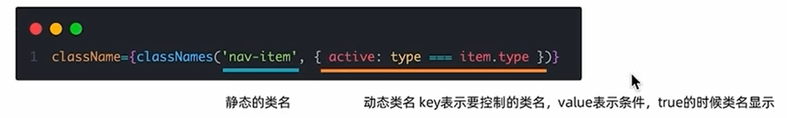
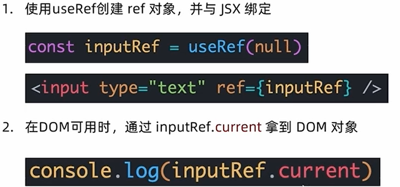
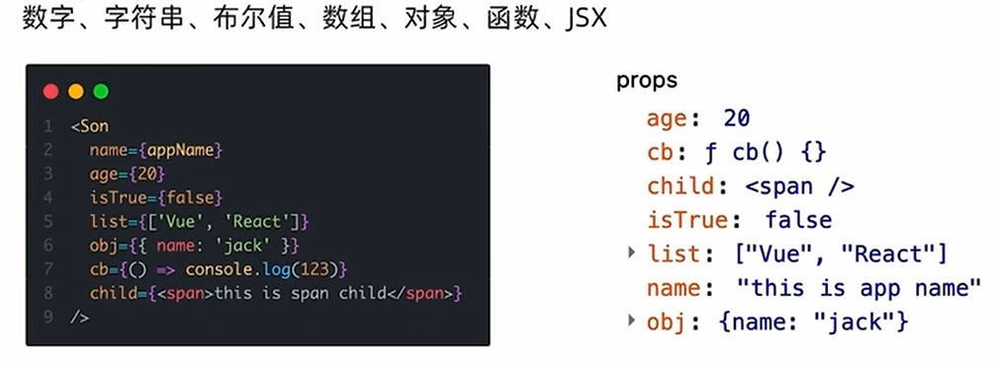
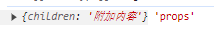
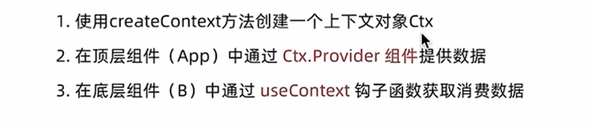
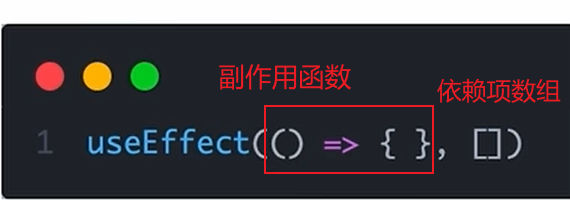
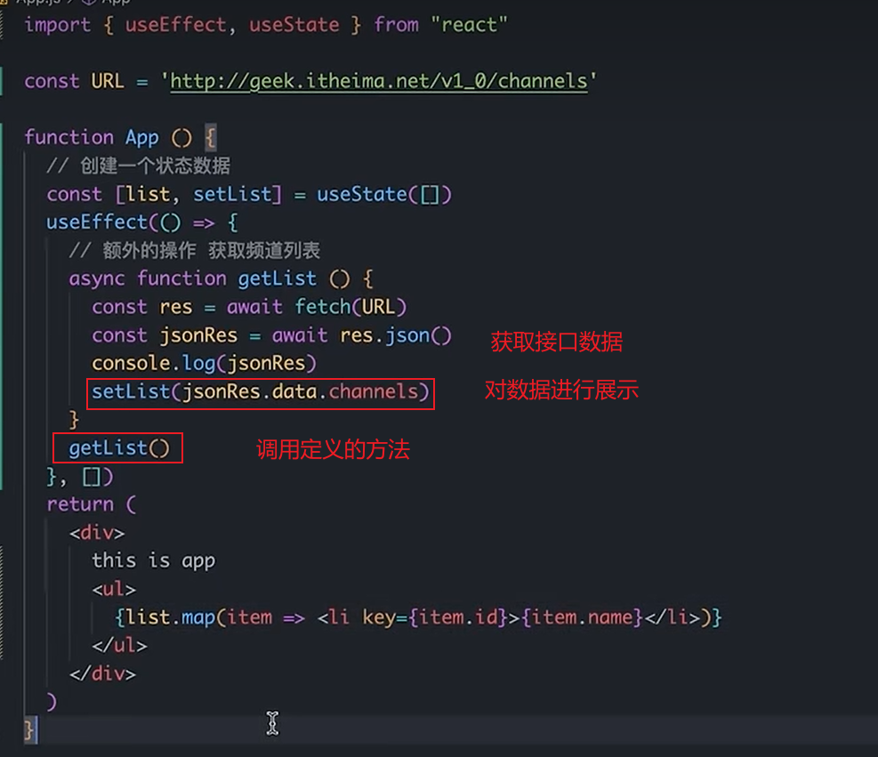

# React

## 搭建流程

npx create-react-app(固定写法) react-admin(自定义项目名称)

## 文件结构

APP.js 相当于Vue中的app.vue，是整个项目的根节点

index.js相当于Vue中的main.js,是整个项目的入口文件

## JSX概念

是react编写模版的方式，相当于Vue中的template模版。

用&#123;&#125;进行语法的编写，其中可以使用js变量及对象，方法的调用

```javascript
<div style={{color:'red'}}> hhh </div> 这里于Vue不同
```

在写模版内容时，对于重复渲染的元素要有一个唯一的值作为其key值.其作用为提升更新性能

```javascript
function App() {
  return (
    <div className="App">
      <ul>
        {lists.map(item => <li key={item.id}>
          {item.name}
        </li>)}
      </ul>
    </div>
  );
}
```

## 基础事件的绑定

on + 事件名称 = &#123; 事件处理程序 &#125;

```javascript
const logFunc = () => {
  console.log('jjj');
}

function App() {
  return (
    <div className="App">
      <button onClick={logFunc}>点击打印</button>
    </div>
  );
}
```

传递自定义参数和事件对象

```javascript
function App() {
const logFunc = (e,name) => {
  console.log('jjj',name);
}
  return (
    <div className="App">
      <button onClick={(e)=>logFunc(e,'jack')}>点击打印</button> //注意一定是箭头函数的写法
    </div>
  );
}
```

## React 自定义组件

是首字母大写的函数

```javascript
//定义组件
function Button() { //普通函数形式
  //组件逻辑
  return <button>Button组件</button>
}

//定义组件
const Button = ()=> { //箭头函数形式
  //组件逻辑
  return <button>Button组件</button>
}

//在根元素中使用
function App() {
  return (
    <div className="App">
      <Button />
    </div>
  );
}
```

## useState

是一个hooks函数，在react中应该对状态进行替换而不是直接修改，直接修改不会引发视图的更新

```javascript
function App() {
  const [count, setCount] = useState(0) //count为要修改的变量，setCount为修改的方法
  const handleClick = () => {
    setCount(count + 1); //修改count的值，重行渲染页面
  }
  return (
    <div className="App">
      <span >{count}</span>
      <button onClick={handleClick}>点击count自增</button>
    </div>
  );
}
```

对于对象类型的状态变量，应该始终传给set方法一个全新的对象来进行修改

```javascript
function App() {
  const [form, setForm] = useState({
    name: 'jack'
  }) 
  const handleName = () => { //用来修改name
    setForm({
      ...form,
      name: 'bob' //这里的结构要与form的数据结构保持一致
    }); 
  }
  return (
    <div className="App">
      <span>{form.name}</span>
      <button onClick={handleName}>自增</button>
    </div>
  );
}
```

## 组件的样式

class类名控制，使用className,而非Vue中的class

```javascript
import './index.css';

<span className="main" > </span>
```

### Tab栏的切换通用思路

点击哪个tab就把其唯一的标示记录下来，在className中做动态的判断，当前的标示与保存的标示一致，则添加激活样式

### 优化类名控制的工具 classNames



## 受控绑定表单

```javascript
function App() {
  const [value , setValue] = useState('')
  return (
    <div className="App">
      <input type="text"
        value={value}
        onChange={(e)=> setValue(e.target.value)}
      >
      </input>
 
    </div>
  );
}
```

通过改变react状态控制表单的状态，类似于Vue中的数据双向绑定，通过value属性绑定react状态，通过onChange事件，拿到参数e的最新值，反向修改到react状态

## 获取DOM元素

使用useRef获取dom，类似Vue的ref，下图为获取的步骤



## 组件通信

### 父传子

1.父组件向子组件传递数据

2.子组件接收数据

```javascript
//子组件
function Son(props) {  props接收数据
  console.log(props, 'props'); 传过来的props是对象
  return (
    <div >
      <span>子组件</span>
      <br></br>
      <span>{props.name}</span>  调用父组件传递的值
    </div>
    
  )
}


//父组件
function App() {
  const [value, setValue] = useState('')
  return (
    <div className="App">
      <input type="text"
        value={value}
        onChange={(e) => setValue(e.target.value)}
      >


      </input>
      <Son name={value} /> name是自定义的属性值

    </div>
  );
}
```

### props的说明

可以传递任意数据。但它是只读属性，想要修改只能在父组件中修改



当在子组件中写入内容时，父组件会自动在child属性中接收这些内容

```javascript
<Son >
<span> 附加内容 </span>
</Son >


<span> 附加内容 </span>  这段内容也会出现在子组件的props的child中，即children:<span />

function Son(props) {
  console.log(props, 'props');
  return (
    <div >
      <span>{props.children}</span>  //显示‘附加内容’
    </div>

  )
}
```



### 子传父

在子组件中调用父组件中的函数并传递实参

```javascript
function Son( { onSendMsg }) {
  const sonMsg = 'this,is ,msg'
  return (
    <div >
      <button onClick={() => onSendMsg(sonMsg)}>sendMsg</button>
    </div>

  )
}

function App() {
const [msg, setMessage] = useState('')
  const sendMsg = (msg) => {
    setMessage(msg)
  };

  return (
    <div className="App">
      <Son onSendMsg={sendMsg}>
					展示子组件数据:{msg}   //展示内容为this,is ,msg
			</Son>
    </div>
  );
}
```

### 兄弟组件的通信

1. 实现A组件的信息传递到B组件可以先将A的信息传递给父组件，再有父组件传递给B组件。间接的实现A到B之间的信息传递

### 2.使用Contnext机制跨层级组件通信



```javascript
import { createContext } from "react";
const MsgContent = createContext();


底层组件
function Child() {
  const detail = useContext(MsgContent)
  return (
    <div>
      <span>{detail}</span>
    </div>
  )
}


顶层组件
function App() {
  const detail = 'detail';
  return (
    <div className="App">
      <MsgContent.Provider value={detail}>
      <Child/>
      </MsgContent.Provider>
    </div>
  );
}
```

## useEffect

用于组件中创建不是由事件引起而是由渲染本身引起的操作。




