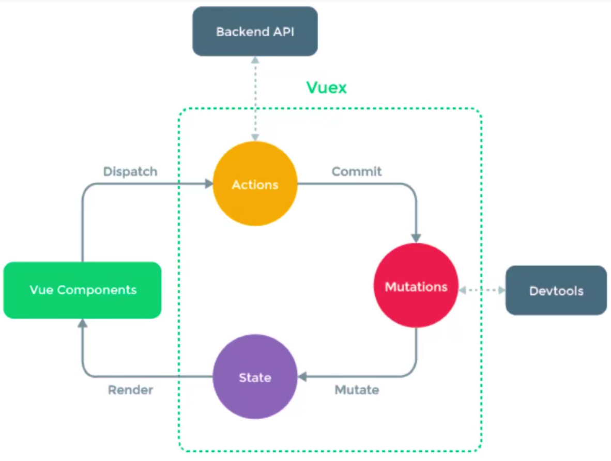
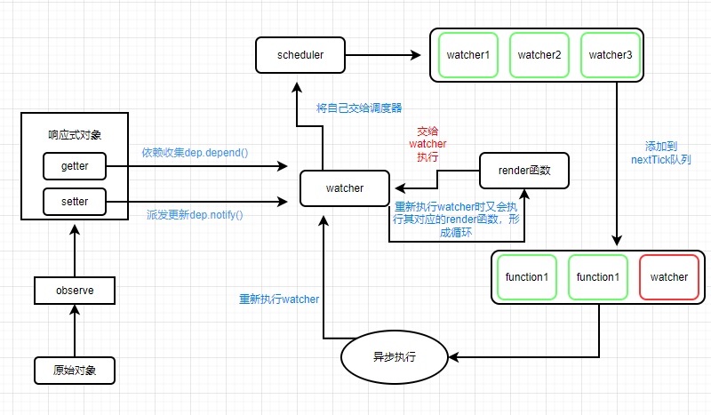
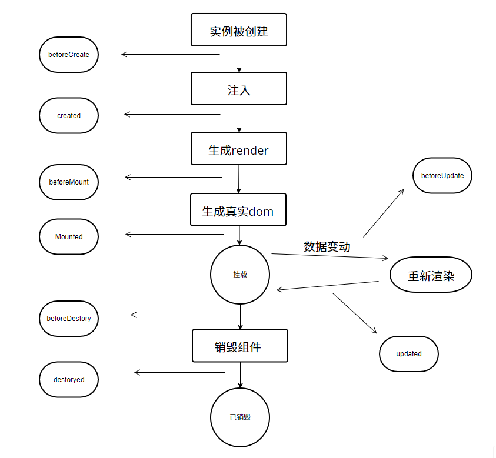
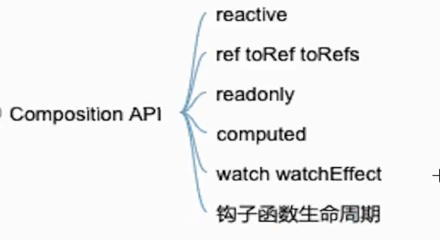
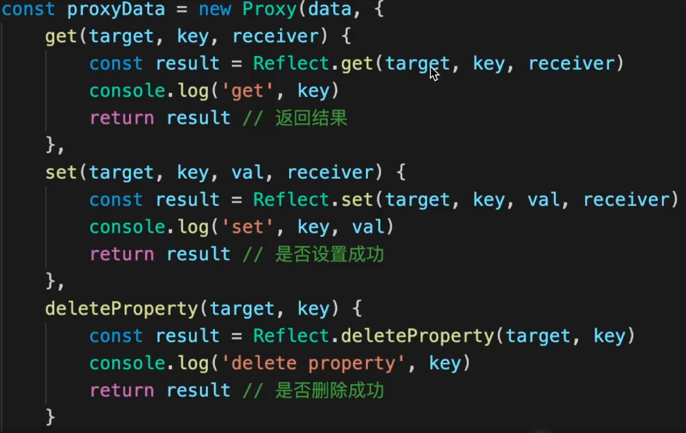

# Vue面试题

深度监听

```javascript
watch:{
info: {
handler(old,newVal){
		log...

}

deep:true; //深度监听
}

}
```

## 父子组件间的通信

props（最常见的通信方式）；$emit（子组件通知父组件）；

attribute（子组件中没有声明的，但父组件传递给了子组件），子组件可以通过$attrs获取到父组件传递过来的attribute

native修饰符，例如父组件中的click.native=handleChange,在子组件的根元素上就会有这个点击方法

$listeners,v-model,sync修饰符（实现属性的双向绑定）；$parent和$children(分别获取子组件和父组件的实例)

$slots和$scropedSlots; $refs（父组件可以通过ref获取到子组件的实例）

###  $refs的弊端

1、破坏了数据驱动的原则： 直接通过$refs访问子组件或DOM元素，可能会导致代码变得难以维护和理解，因为它绕过了Vue的响应式系统，破坏了数据驱动的原则。

2、不利于组件的复用： 使用$refs会使得组件之间的耦合度增加，降低了组件的复用性，因为父组件需要知道子组件的具体结构才能通过$refs进行访问。

3、不利于单元测试： 直接通过$refs来访问子组件或DOM元素，会增加单元测试的复杂度，因为测试需要关注到$refs的使用情况，而且$refs在测试环境中可能不容易模拟。

4、性能影响： 当使用$refs时，Vue会在渲染过程中去收集和更新$refs，可能会对性能产生一定影响，尤其是在大型应用中。

### .sync的实现原理

```javascript
<text-document
  v-bind:title="doc.title"
  v-on:update:title="doc.title = $event"
></text-document>

等价于：
<text-document v-bind:title.sync="doc.title"></text-document>
```

## 自定义事件，Vue实例中自带

绑定自定义事件：可以通过vm.$on。事件可以由 `vm.$emit` 触发。回调函数会接收所有传入事件触发函数的额外参数。

在beforeDestory中解绑自定义事件

## v-if 与v-show的区别

vif适用于更新不频繁的元素显示，vshow则用于频繁切换状态的元素

## 跨组件间的通信

provide（父组件提供数据）和inject（后代组件接受父组件提供的数据）

router；vuex（适用于大型项目的数据仓库）；store（适用于中小型数据仓库）

eventbus全局事件总线

### 子组件暴露方法通常适用于以下场景

1、父子组件通信： 当子组件需要将一些数据或操作传递给父组件时，可以通过暴露方法的方式实现父子组件之间的通信。

2、封装复杂逻辑： 如果子组件包含一些复杂的逻辑或功能，可以将这些逻辑封装在子组件中，并通过暴露方法的方式让父组件调用这些功能。

3、重用性： 子组件暴露方法可以增加组件的重用性，使得同一组件在不同场景下能够提供不同的功能，而不需要重复编写相似的代码。

4、提供接口给其他组件使用： 如果子组件提供了一些通用的功能或接口，可以通过暴露方法的方式让其他组件使用这些功能。

## 虚拟DOM

是什么：本质是普通的js对象，用来描述界面的结构

为什么需要：由于VUE设计的render函数在依赖数据发生变化时就要更改页面内容，而真实dom中的属性是巨量的，如果在render函数中直接创建真实dom会对数据及页面的渲染造成极大的负担，严重降低渲染效率。所以虚拟dom替代真实dom主要是为了解决渲染效率的问题。

是如何转换成真实dom的：

1、当组件第一次进行渲染时，首先生成虚拟dom树，根据虚拟dom树来创建真实dom，并把真实dom挂载到页面的指定位置。此时，每个虚拟dom都与真实dom一一对应。

2、当页面中 的数据发生变化时，重新调用render函数，创建出新的虚拟dom树，并且和之前的虚拟dom树进行对比 （patch），发现最小更新的地方，并更新必要的虚拟DOM节点，然后这些修改后的虚拟DOM节点会去修改他们对应的真实DOM节点，从而保证了真实DOM的最小改动而非全部更新

模版和虚拟DOM之间的关系：

vue存在的编译模块会将模版转换为render函数，render函数调用后产生虚拟DOM

## ·Vuex

state（定义需要全局使用的状态），getters（相当于vue中的计算属性）、action（异步操作的执行）、mutation（只能进行同步的操作）

mutation 中修改数据：

```javascript
state(){
	return {
		loginStatus:'用户登录状态'
		}
}

getters:{
	len(state){
		return state.loginStatus.length
	}
}

在使用时这样使用：
handler(){ //这是某个处理的函数
	this.$store.getters.len //输出6
}

mutation:{
	changeCount(state,num){
			state.count += num //只能通过state.的方式获取到state中定义的变量	
		}
	}
	
在使用时这样使用：
handler(){ //这是某个处理的函数
	this.$store.commit('changeCount',1) //第一个参数为mutation中定义的名称,
	//第二个参数传入changeCount中所需要的num形参
}

//在action中也只是对mutation中的操作进行异步的处理，而不能直接将对对象的修改操作放到action中
//所有的修改操作只能在mutation中进行
action:{
	delay(store,num){
		setTimeOut(() => {
			store.commit('changeCount',num)	
			})
		}
	}
	
	在使用时这样使用：
handler(){ //这是某个处理的函数
	this.$store.dispatch('delay',10) //表示执行action中的delay异步方法，
	//并且通过dispatch的方式调用
}
```

### action和mutation的区别

action可以处理异步，mutation不行；

action可以整合多个mutation，mutation做原子操作

组件中的使用：

dispatch
commit
mapState
mapGetters
mapActions
mapMutations



## Vue-router

hash与history模式

```javascript
const router = new VueRouter({
		mode:'history',  //h5的history模式
		routes:[{
			path:'user/:id',component:() => 	import(./demoComponent)		 //组件的懒加载
    //user/:id为动态路由配置
			}]  


	})

在组件中可以使用{{$route.params.id}} 获取到相对应的组件页面id
```

## Vue-router的原理

vue-router实质时vue对前端路由的处理，当前url改变时，触发监听事件———Vue-router改变当前current变量的值——vue监听current的监听者——获取到新的组件并渲染。其中不同模式的监听事件都不一样，hash是onHashChange触发（可以用location.hash拿到当前的值）；history模式的话使用pushState（可以改变url地址且不会发送请求）和replaceState（可以读取历史记录栈,还可以对浏览器记录进⾏修改）,onpopstate可以对history的路由变化进行监听（可以用location.pathname拿到当前的值）

### 前端为什么用history模式会出现404

因为在history模式下是会通过修改 URL 的路径部分来实现路由切换的，在切换时它会向服务器发送 GET 请求，但此时服务器并没有配置相应的资源来匹配这个请求，因此返回 404 错误。可以通过nginx配置try_file的方式解决。之所以用hash模式不会出现404的错误是因为 url 中 # 号后面的内容不会发给后端当作资源路径请求服务器。

## 数据响应式原理

通过Object.defineproperty遍历对象的每一个属性，把每个属性变成getter（获取值）和setter（赋值）。在运行render函数时，所使用到的依赖数据会被getter收集到（依赖收集），Watcher会监听这个数据，当这个数据发生变化被重新赋值时，setter会通知Watcher数据发生了改变，Watcher会重新执行render函数，从而形成新的虚拟DOM树。

实现响应式的过程中，Vue使用到了这几个核心部件：Observe,Dep,Watcher

Observe:作用是让一个对象，它的属性的读取，更改的变化，赋值都可以被Vue感知到（其目标是把普通的对象转换为响应式的对像，例如一个原始对象通过observe后被设置了getter与setter）。可以使用Vue的静态方法Vue.observable(object)间接使用该功能。发生在beforeCreate之后和created之前。

arr.__proto__ = vue自定义的对象 = Array.prototype,通过中间增加自定义对象就可以感知数据，否则使用常规的方法例如delete arr[0]的方法是无法被检测到变化的。

Dep(依赖):解决读取属性和属性变化时都要做什么事.vue会为响应式对像中的每一个属性、对象本身、数组本身创建Dep实例，每个Dep实例做两件事：记录依赖dep.depend()（谁在用我）；派发更新dep.notify()（发生变化后，通知那些使用我的地方）

Watcher(让Dep知道谁在用它）

先设置一个全局变量，让全局变量记录当前负责执行的watcher等于自己，然后再去执行函数。当函数执行时，如果发生了依赖收集，则Dep会记录下这个全局变量，表示有一个watcher用到了我这个属性。当Dep派发更新的时候，会通知之前记录到的所有watcher，说明我这个属性值变了。之后watcher会重新运行render函数（也可能是其他函数），重新渲染页面并保存最新的依赖

Scheduler调度器(优化效率）

当watcher接受到派发更新后，会交给调度器。调度器会将watcher加入执行队列中，同一个watcher只会存在一次，之后会通过nextTick，将这些需要执行的watcher放入事件循环的微队列中，即用异步方法promise执行。当页面上的同步操作施行完之后，就开始处理这些watcher异步操作。（简而言之，在响应式数据发生变化时，render函数的执行是异步的，并在微队列中）异步执行过后又触发了render函数，继而继续调用watcher函数，重新记录收集依赖，如此往复。从而实现数据响应的整个流程。



### **vue3响应式原理**

与vue2通过`Object.defineProperty`实现响应式不同，vue3利用了`Proxy`的相关api。查看源代码我们会发现有三个部件为响应式提供了核心实现能力：**`reactivity、@vue/runtime-dom`**`、` **`@vue/runtime-core`**

- `reactivity`: 为数据提供响应式的能力，我们日常开发中出现的`reactive`、`ref`等函数都出自该项目中；
- `@vue/runtime-dom`: 针对浏览器的运行时，内部会涉及到`DOM API`，其依赖于`@vue/runtime-core`提供的能力；
- `@vue/runtime-core`: 平台无关的运行时核心，内部依赖`reactivity`提供的数据响应式能力了。有了这个核心库，就可以针对特点平台自定义渲染器，`@vue/runtime-dom`就是案例。

原文链接：[05.Vue3响应式系统源码实现2 | 杨艺韬的官方网站 (yangyitao.com)](https://www.yangyitao.com/vue3/05.Vue3%E5%93%8D%E5%BA%94%E5%BC%8F%E7%B3%BB%E7%BB%9F%E6%BA%90%E7%A0%81%E5%AE%9E%E7%8E%B02.html)

## ·Computed计算属性

### 特点：有缓存，可以提高性能

### 计算属性与watch的区别：

计算属性 (computed)：

对于任何复杂逻辑，都应当使用**计算属性**

计算属性是基于它们的依赖进行缓存的。只有在依赖发生改变时，计算属性才会重新求值。
计算属性适合用于基于现有数据计算出新数据的情况，比如对数据进行筛选、排序、格式化等操作。
计算属性是响应式的，当依赖的数据发生变化时，计算属性会自动更新。

监听属性 (watch)：

当需要在数据变化时执行异步或开销较大的操作时，应该使用监听器

监听属性是用来监听特定数据的变化并做出相应的操作。
监听属性适合用于需要在数据变化时执行异步或开销较大的操作的情况，比如发送网络请求或执行复杂计算。
监听属性提供了更多灵活性，可以监听任意数据的变化，而不仅限于计算属性所依赖的数据。

### 计算属性与methods的区别：

标准回答：计算属性可以当做属性使用，而methods当做方法使用

计算属性具有getter和setter，可以赋值，而methods不行

计算属性无法接收参数，而methods可以

计算属性有缓存，而methods没有

**接近底层的回答**

对methods的处理：遍历其中的每个属性，将其对应的函数通过bind绑定到当前组件实例后复制其引用到组件实例中即可

对computed的处理（在组件实例触发beforereate生命周期后进行）：核心是watcher、lazy（懒加载）、value、dirty（脏值）

首先，会遍历computed配置中的所有属性，为每一个属性创建一个对应的Watcher对象，并传入一个函数，该函数的本质其实就是computed配置中的getter，这样一来，getter运行过程中就会收集依赖。

计算属性中的watcher不同于render函数中的watcher，它不会立即执行，因为要考虑到这个计算属性是否被render函数使用到了，若没有使用到，那么就不会执行watcher。所以lazy配置可以让watcher不会立即执行。

computed缓存的实现依靠value、dirty两个关键属性实现：

value属性用于记录存Watcher运行的结果，一开始受到lazy的影响，value的值为undefined

dirty属性用于指示当前的value 是否已经过时，即是否为脏值，受lazy的影响，该值在最开始是true，即value应该为计算属性中的值，而现在则为undefined，所以开始为true

当watcher创建好之后，Vue通过代理模式，将计算属性挂载到组件实例中

当读取计算属性时，vue检查其对应的Watcher是否是脏值，如果为true，则运行函数，计算依赖，并得到对应的值，保存在Watcher的value中，然后设置dirty为false，然后返回。若为false，则直接返回watcher中value的值（这一步体现了计算属性具有缓存的特点）。

```sql
if(dirty) {
	getter();
	value:newValue;
	dirty:false
} else {
	return value
}
```

同时，在依赖收集时，被依赖的数据不仅会收集到计算属性的Watcher，还会收集到组件的Watcher。当计算属性的依赖变化时，会先触发计算属性的Watcher执行，此时，它只需设置dirty为true即可，不做任何处理。
由于依赖同时会收集到组件的Watcher，因此组件会重新渲染，而重新渲染时又读取到了组件中所使用到的计算属性，由于计算属性目前的脏值已经为true，因此会重新运行getter进行运算，将value设置为新值，最后再将dirty设置为false

而对于计算属性的setter，则极其简单，当设置计算属性时，直接运行setter即可

## Diff算法

时机：_update函数的执行过程中，时间复杂度On

当组件创建时，以及依赖的属性或数据变化时，会运行一个函数，该函数会做两件事:。运行render生成一棵新的虚拟dom树 (vnode tree)。运行_update函数，传入虚拟dom树的根节点，对新旧两棵树进行对比，最终完成对真实dom的更新

对比的过程（patch函数）：

1、根节点的比较，如果两个节点相同（key值和标签值都相同，input元素中还要看type值是否也相同），则进入更新流程(updateChildren)：

将旧节点的真实dom赋值到新节点: newVnode.elm = oldVnode.elm

对比新节点和旧节点的属性，有变化的更新到真实dom中

当前两个节点处理完毕，开始对比他们的子节点

如果两个节点不同：

新节点进递归，创建新元素(addVnodes)

对旧节点进行销毁node.remove()(removeVnodes)

2、子节点的比较原则：

相同直接复用，或者改动元素属性，再或者移动元素位置，最后才是删除和创建元素。

也就是说能不更改元素就不更改，实现真实dom的最小化改动，提高渲染效率

### 回答：

当组件创建和更新时，vue均会执行内部的update函数，该函数在内部使用render函数生成虚拟dom树，然后vue将新旧两树进行对比，找到差异点，最终更新到真实dom
对比差异的过程叫diff，vue在内部通过patch函数完成该过程。在对比时，vue采用深度优先、同层比较的方式进行比对，在判断两个节点是否相同时，vue通过虚拟节点的key和tag来进行判断的。

具体来说，首先对根节点进行对比，如果相同则将旧节点关联的真实dom的引用挂到新节点上，然后根据需要更新属性到真实dom，然后再对比其子节点数组;如果不相同，则按照新节点的信息递归创建所有真实dom，同时挂到对应虚拟节点上，然后移除掉旧的dom。

在对比其子节点数组时，vue对每个子节点数组使用了两个指针，分别指向头尾，然后不断向中间靠拢来进行对比，这样做的目的是尽量复用真实dom，尽量少的销毁和创建真实dom。如果发现相同，则进入和根节点样的对比流程，如果发现不同，则移动真实dom到合适的位置
这样一直递归的遍历下去，直到整棵树完成对比。

## 生命周期

创建Vue实例流程：

1、一些初始化操作，主要时设置一些私有属性到实例中

**2、运行生命周期函数beforeCreate**

3、进入流程：处理属性、computed、methods、data、provide、inject，最后使用代理模式将他们挂载到实例中

**4、运行生命周期函数created**

5、生成render函数:如果有配置，直接使用配置的render，如果没有，使用运行时编译器，把模板编译为 render

**6、运行生命周期函数 beforeMount**

7、创建一个Watcher，传入一个函数 updateComponent，该函数会运行render，把得到的vnode再传入_update函数执行。在执行render 函数的过程中，会收集所有依赖，将来依赖变化时会重新运行updateComponent函数。在执行_update函数的过程中，触发patch 函数，由于目前没有旧树，因此直接为当前的虚拟dom树的每一个普通节点生成elm属性，即真实dom。（该过程用到了diff算法）
如果遇到创建一个组件的vnode，则会进入组件实例化流程，该流程和创建vue实例流程基本相同，最终会把创建好的组件实例挂载vnode的componentInstance属性中，以便复用。

**8、运行生命周期函数mounted**



### 重渲染问题（数据响应式原理）：

1、数据变化后，所有依赖该数据的watcher均会重新运行，这里仅考虑updateComponent 函数对应的watcher

2、watcher 会被调度器放到nextTick中运行，也就是微队列中，这样是为了避免多个依赖的数据同时改变后被多次执行
**3、运行生命周期钩子函数beforeUpdate**
4、updateComponent函数重新执行。在执行 render 函数的过程中，会去掉之前的依赖，重新收集所有依赖，将来依赖变化时会重新运行updateComponent函数。在执行_update函数的过程中，触发patch函数新旧两棵树进行对比。

普通 html节点的对比会导致真实节点被创建、删除、移动、更新组件节点的对比会导致组件被创建、删除、移动、更新。当新组件需要创建时，进入实例化流程。当旧组件需要删除时，会调用旧组件的$destroy 方法删除组件，该方法会先触发**生命周期钩子函数beforeDestroy，**然后递归调用子组件的$destroy方法，然后触发**生命周期钩子函数destroyed。**当组件属性更新时，相当于组件的updateComponent 函数被重新触发执行，进入重染流程，将上述流程再次重复。

**5、运行生命周期钩子函数updated**

## 作用域插槽

解决父组件中的插槽要使用子组件中相对应插槽中的数据的问题，

```javascript
父组件：

<children :data="childrenData">

<template #loading>加载中...</template>

<template v-slot :default="{ content }"> //这样就可以使用子组件中的数据
<li v-for="item in content" :key="[item.id](http://item.id/)">

{{item}}

</li>
</template>

<template v-slot:error="error"> //v-slot=error替代
		<p style="color:red"> 
			{{ error.message }}  //error.error.message 替代
		</p>
</template>

</children>

子组件：

<template>

<div>
      <slot name="loading” v-if="isLoading">
					默认加载中的效果...
			</slot>

<slot name="error” v-else-if="error"  :error="error">{{ error ))</slot>

//通过 v-bind 将子组件的插槽数据绑定到了组件插槽的位置 :

<slot name="default" v-else  :content="content" (( content ))</slot>

</div>

</template>
```

通过$slots和$scopedSlots两个属性可以获取到插槽的详细信息

$slots存储的是普通插槽的vnode

$scopedSlots存储的是所有的插槽

## 过渡和动画

也可以借助这种方式来实现轮播图的效果

1、只能作用在一个元素中，即transition标签中只能有一个元素，就像template标签一样。

2、如果transition标签内没有定义name，则默认为v-xxx，如果定义了则为xxx-enter-active\xxx-leave-active,详情见文档：[https://cn.vuejs.org/guide/built-ins/transition.html#css-based-transitions](https://cn.vuejs.org/guide/built-ins/transition.html#css-based-transitions)

### 过渡组transition-group

其生成元素，使用tag属性控制生产何种元素例如&lt;transition-group tag=’ul’&gt;,默认生成span元素。

并监控内部是否有新元素生成，旧元素消失，对新元素应用enter效果，对消失元素应用leave效果 。

对于现有的元素可以使用xxx-move类名来控制其动画效果，不添加的话新增的元素会影响到其他元素的位置，从而造成其他元素位置的直接移动，没有平滑的过渡效果。对于删除的元素的过渡效果可以在xxx-leave-avtive时将其他元素设置为绝对定位。这样一删除元素其他元素就会立即改变原有位置，从而被transition-group监控到

## ·VUE优化

### 1、使用key，有利于在列表变动时，尽量少的新增或删除元素（diff算法）

### 2、使用冻结对像

其不会被响应化，使用object.freeze来冻结，适用于那些数据不会变化，仅作为展示的内容。可以减少Vue将其变为响应式的时间

### 3、使用函数式组件

### 4、使用计算属性

利用计算属性的缓存特点，减少重复数据的渲染

### 5、非实时绑定的表单项

当使用 v-model 绑定一个表单项时，当用户改变表单项的状态时，也会随之改变数据（因为是双向绑定），从而导致 vue 发生重渲染 (rerender) ，这会带来一些性能的开销。
特别是当用户改变表单项时，页面有一些动画正在进行中，由于JS执行线程和浏览器渲染线程是互斥的，最终会导致动画出现卡顿。
我们可以通过使用 lazy 或不使用 v-model 的方式解决该问题，但要注意，这样可能会导致在某一个时间段内数据和表单项的值是不一致的

### 6、保持对象引用稳定

绝大多数情况下，Vue中的render函数触发的时机是当依赖的数据发生变化时。所以说只要保证组件中所依赖的数据不发生变化，组件就不会被渲染。

对于原始数据类型，保持其值不变即可
对于对象类型，保持其引用不变即可
从另一方面来说，由于可以通过保持属性引用稳定来避免子组件的重渲染，那么我们应该细分组件来尽量避免多余的渲染

### 7、使用v-show替代v-if

对于频繁切换显示状态的元素，使用v-show可以保证虚拟dom树的稳定，避免频繁的新增和删除元素，特别是对于那些内部包含大量dom元素的节点，这一点极其重要

### 8、使用延迟装载(defer)

让组件按照指定的先后顺序依次进行渲染，而不是一下子全部渲染出来，虽然渲染的总时长没有大的变化，但是用户的直观感受大大提升。本质上是利用requestAnimationFrame事件分批渲染内容

### 9、使用keep-alive

将组件进行缓存，适用在需要频繁切换组件的场景。通过缓存组件，减少组件实例的创建带来的渲染时间。即切换组件时并不会销毁组件。

### 10、使用v-for时不要同时使用v-if

当 v-for 和 v-if 同时存在于同一个元素时，v-for 的优先级高于 v-if。这意味着在每次渲染时，v-for 都会被执行，而 v-if 只是在每次 v-for 循环中被检查。

### 11、长列表优化

本质是不要渲染全部的列表数据，而是在有限的元素中展示有限的数据，只不过这些有限的数据是不断被替换的，从而实现虚拟列表的效果，最终通过减少渲染数据量来提升渲染效率

可以使用Vue-virtual-scroller组件实现

### Vue首屏加载优化手段

1、路由懒加载

2、使用异步组件，动态渲染所需要的组件

## Vue相关的高级特性

### ·1、自定义v-model

v-model即可作用于表单元素，又可作用于自定义组件，本质上是个语法糖，最终会生成一个属性和一个事件

作用于表单元素时，Vue会根据不同的表单元素生成不同的属性和事件，例如普通文本框会生成value属性和input事件，当为单选或多选框时，会生成checked和change事件；作用于自定义组件时，默认会生成value属性和input事件

在vue3中则使用defineModel实现：

[https://www.notion.so/Vue-3a32ff10c6324f8aa31a4868baaa6125?pvs=4#74fb58a31a0c4673abf1be340a15135d](https://cn.vuejs.org/guide/components/v-model.html#component-v-model)

```javascript
<script setup>
const props = defineProps(['modelValue'])
const emit = defineEmits(['update:modelValue'])
</script>

<template>
  <input
    :value="props.modelValue"
    @input="emit('update:modelValue', $event.target.value)"
  />
</template>
```

```javascript
<children v-model=”data” />
//等于下列的写法
<children :value=”data” @input=’data = $event’ />

也可以通过model修改生成的属性和事件：

const children ={
	model:{
		prop:"number"  //默认为value
		event:"change" //默认为input
	}
}
```

```javascript
<customModel v-model="name" />

//在customModel 组件中：
<template>

<input :value="text
				type="text"
				:input="$emit("change",$event.target.value)"  //其中的change对应model中的change
/>

export default{
		model:{
			prop:"text",  //对应props中的text
			event:"change"
	},
		props: {
			text:String,
			default() {
				return ''
		}
	}
}
```

### ·2、$nextTick

该方法在DOM渲染之后回调，不论操作有多少次，nextTick只会调用一次,从而获取最新的节点

### 3、slot

作用域插槽与普通插槽常考，作用域插槽看上面的文章[作用域插槽](https://app.notion.com/p/3a32ff10c6324f8aa31a4868baaa6125#b8649f673078434d8e10a7ac385a6330)

### 4、动态组件

:is=”component-name”,根据数据动态的渲染组件；

### ·5、异步加载组件

```javascript
//使用import在components中动态的引入组件，(什么时候用到什么时候加载）
export default{
	components:{
		demo:() => import(../../demo.vue)
	}
}

使用场景：优化性能
```

### 6、keep-alive

主要用于组件间切换时将组件缓存起来，而不是每次切换组件都将上一个组件销毁，当前组件挂载，提升性能。可以将需要缓存的组件包含到&lt;keep-alive&gt;&lt;/keep-alive&gt;中

使用场景：

缓存组件，不需要重复渲染

多个静态tab页的切换

优化性能

### ·7、mixin

抽离多个组件中的公共逻辑

```javascript
export default{
	mixins:[myMixin] //可以添加多个
}

myMixin.js文件：

export default{
	data() {
		return {
			name:'joe'
		}
	}

	methods:{
			showName(){
				console.log(this.name)
			}	
		},
}
```

问题：变量来源不明确，不利于阅读；多mixin可能会造成命名冲突；mixin和组件可能出现多对多的关系，复杂度较高

## MVVM（model view ViewModel）

数据驱动视图

避免频繁的操作dom，使得页面更好的维护

model对应数据，view对应html模板以及内容 结构，viewModel对应各种事件

## ·Object.defineproperty

实现vue响应式的核心api，通过get和set实现对普通对象的监听

### 缺点：

深度监听需要递归到底，一次性的计算量大

无法监听新增和删除属性，需要vue.set 和vue.delete完成

无法监听原生数组，需要特殊处理

```javascript
重新定义数组原型
const newArrayPrototype = Array.prototype;
const arrProto = Object.creat(newArrayPrototype )
创建的arrProto 原型指向newArrayPrototype ，扩展新的方法不会污染到Array原型；

[ 'push',' pop','shift','splice','unshift'].forEach(methodName = 
arrProto[methodName] = function() {
updateView() // 触发视图更新
newArrayPrototype [methodName].call(this,...arguments)
}})
```

## ·为什么data是一个函数

不是函数的话每个组件的数据都会共享，因为vue文件是一个类，使用组件就是实现类的实例化的过程

## ·Ajax放在哪个生命周期里面

mounted周期中，因为js为单线程语言，Ajax是异步获取数据的。当页面都渲染完毕后再去获取数据，逻辑会很清晰

## ·何时使用beforeDestory

解绑自定义事件event.$off

清除定时器

解绑自定义dom事件，例如scroll事件

## ·vue为何是异步渲染

异步渲染以提高渲染性能，同时合并data的修改请求

## ·vue3相对于vue2的优势

性能更好、体积更小、很好的ts支持、很好的代码组织、更好的逻辑抽离、更多的新功能

## ·vue3新功能

createAPP

emits属性

多事件处理

fragment

移除sync改为v-model

异步组件的引用方式

移除filter

Teleport

Suspense

### composition api



## ·vue3的响应式原理（proxy）



### reflect

和proxy能力一一对应

规范化、标准化、函数式

替代掉Object的工具函数

### 相对于object.defineproperty的优点

性能更快，因为在深度监听对象时，只有使用到的对象才会变成响应式对象，而不像object.defineproperty一次性全都遍历完

可监听新增和删除的属性

可监听数组的变化

但是无法兼容所有的浏览器，无法polyfill

无法polyfill的原因：其功能无法通过object.defineproperty模拟出来

## ·如何理解ref toRef toRefs

### ref

生成值类型的响应数据；可用于模板和reactive；通过.vlaue的方式修改值

### toRef

针对一个响应式对象（reactive封装）的prop

创建一个ref，具有响应式

两者保持引用关系

### toRefs

将响应式对象（reactive封装）转换为普通对象

对象的每个prop都有对应的ref

两者保持引用关系

避免了reactive封装的对象在直接使用属性名时失去响应式

### ref和reactive声明的响应式变量的区别

ref用于声明单个基本类型的响应式变量，例如数字、字符串等。
通过ref声明的变量，需要通过.value来访问和修改其值。
ref返回的是一个对象，可以通过.value来获取和设置其值。

reactive用于声明包含多个属性的响应式对象。
通过reactive声明的变量，可以直接访问和修改其属性。
reactive返回一个对象的响应式代理，可以直接访问和修改其属性。

```javascript
<p>{{age}}</p> //这样会失去响应式

const state = reactive({
age:20
})//直接return state会失去响应式

const stateRefs = toRefs(state)

return {
state //这样会失去响应式
stateRefs //这样直接使用属性名age就不会失去响应式
}
```

### 使用场景：

用reactive做对象响应式，用ref做值类型响应式

setup中返回toRefs(state)

ref的变量命名都使用xxxRef

合成函数返回响应式对象时，使用toRefs

## ·vue3如何实现代码逻辑复用

将逻辑抽离到函数中，函数的命名为usexxx，在setup中引用usexxx函数

## ·watch和watchEffect的区别

两者都可以监听data属性的变化

watch需要声明监听哪一个属性

watchEffect会根据其中的属性，自动监听其变化,即写了什么监听什么，并且初始化的时候会执行一次

```javascript
watchEffect(() => {
  menuName.value = router.currentRoute.value.meta.title
})
```

## ·setup中如何获取组件实例

在setup和组合式api中没有this

可以通过getCurrentInstance获取当前实例

如果是option api则仍可以使用this

## ·vue3为什么比vue2快

树摇（tree-shaking）

proxy响应式

hoistStatic(将静态节点的定义提升到父作用域缓存起来，多个相邻的静态节点会被合并，称之为静态提升）

patchFlag(编译模板时给节点做标记,以优化diff算法）

cacheHandler（缓存事件）

SSR优化（静态节点直接输出，动态节点动态渲染）

## vite是什么

前端打包工具，有开发环境无需打包，启动快（使用es6 module）的优点

## 组合式api和react hooks的区别

前者setup只会被调用一次，而后者函数会被多次调用

前者无需useMemo,useCallback,因为setup只会调用一次

前者无需考虑调用顺序，后者需要保证hooks的顺序一致

前者的ref + reactive比后者的useState要难理解
